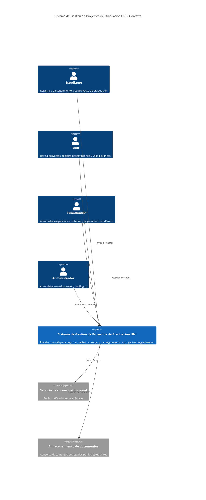
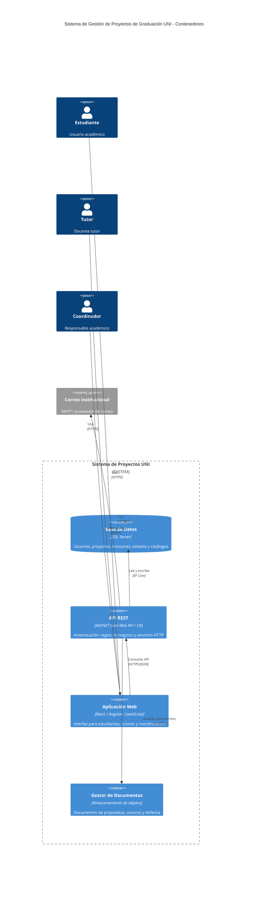
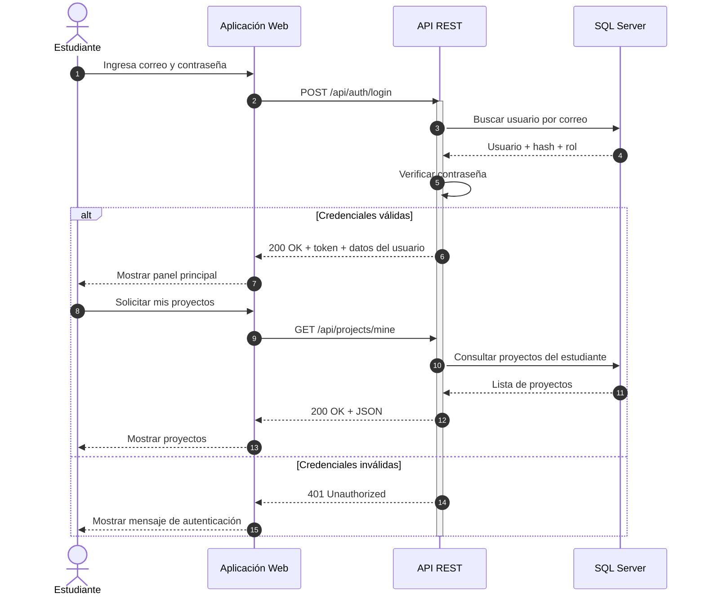

# Sistema de Gestión de Proyectos de Graduación UNI

Plataforma web para registrar, revisar, aprobar y dar seguimiento a proyectos de graduación. Caso de estudio de Ingeniería de Software.

## Arquitectura

### C4 Nivel 1 - Contexto

### C4 Nivel 2 - Contenedores

### Secuencia

## API

El contrato completo está en `openapi.yaml` (OpenAPI 3.0.3).
